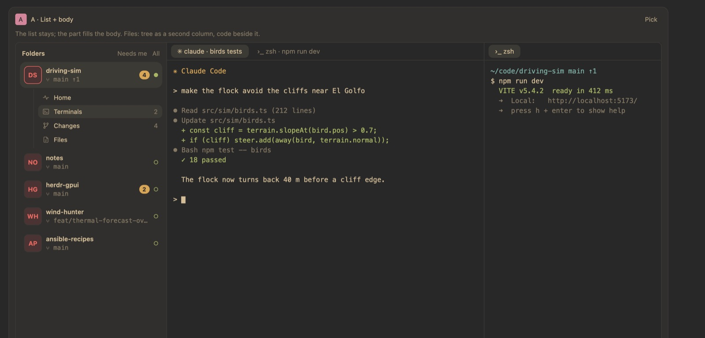
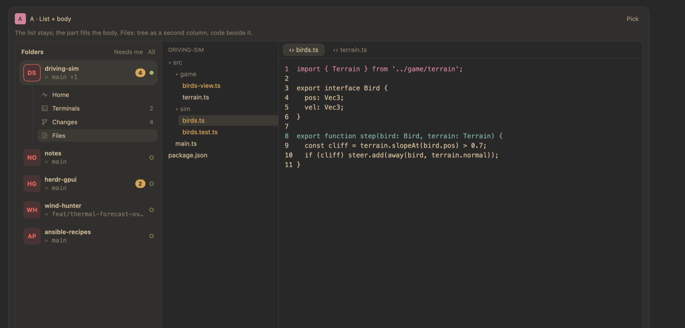

# Folders: a folder's parts in place

Status: built (layout A). Screenshots are from the GPUI mockup, with demo
content.

## The problem

In Folders, the selected folder unfolds into **Home, Terminals, Changes,
Files**. Home and Changes filled the body, but Terminals and Files left
Folders for the Workspaces or Files view, so the folder list disappeared.

The app has two kinds of activity view: columns beside the terminal area
(Workspaces, Files) and sections across the whole body (Overview, Folders,
Changes…). Folders was only ever a section, so it had no terminal area to show.

## The layout: list + body

Four layouts were mocked up (list + body, a deeper navigator list, tabs over
the body, and a rail of folder marks). **List + body** was picked: the folder
list stays as it is, and the picked part fills the rest of the window.

## Behaviour

- ~~**Terminals** keeps Folders and its list, and shows that folder's
  workspace in the window's own terminal area, keyboard in the terminal.~~ ✅
- ~~**Files** adds that checkout's tree as a second column beside the list;
  file tabs list as in the Files view, and code tabs open in the body.~~ ✅
- ~~**Home** and **Changes** stay pages across the body, as before.~~ ✅
- ~~Home's Terminals and Files buttons, and clicking an agent on Home, stay in
  Folders too (an agent opens its pane in the folder's Terminals).~~ ✅
- ~~**Switching folders while in Terminals** shows the other folder's
  terminals at once.~~ ✅
- ~~**Each folder remembers its part.** Clicking a folder opens it at the part
  it was last left on; a folder never opened follows the part shown now.~~ ✅
- ~~Beside the terminals, the unfolded folder follows the workspace the window
  shows, so switching workspaces from the keyboard moves the list with it.~~ ✅
- ~~Uncommitted counts keep refreshing at the shown rate while Folders is a
  column.~~ ✅
- The memory lasts for the window's session; it is not saved across restarts.

## Checks

- ~~Headless tests (`folders/tests/parts.rs`): Terminals and Files keep
  Folders as a column left of the terminal area, Files puts the tree between
  them, Home returns to the page, each folder's part is remembered, and the
  list follows the shown workspace.~~ ✅
- Native check of Terminals and Files in the real window, light and dark,
  wide and narrow.
